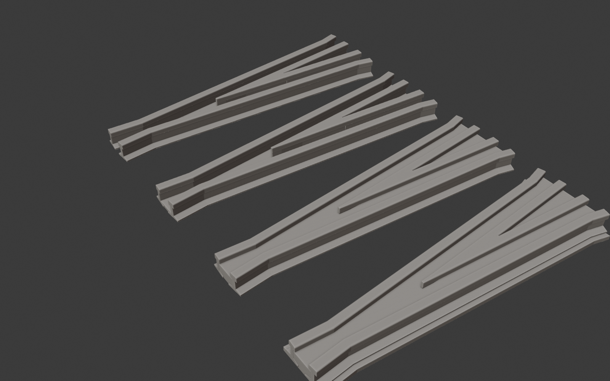
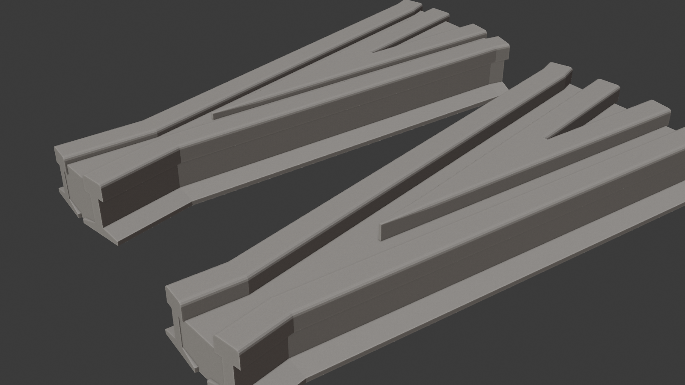
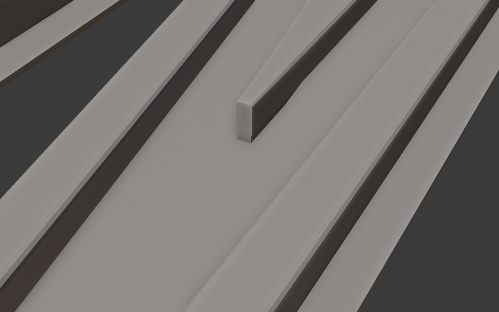

# Switch Frog Generator (Blender add-on)

Generates the frog of a model railroad turnout (switch) as one closed, manifold mesh ready for
3D printing, and exports it to STL or OBJ in millimetres. You choose the **frog number**, which
sets the frog angle, and a **rail profile** from the Model Rail Generator's presets. Frog
settings can be saved as presets of your own. A public Python API lets other add-ons (turnout or
layout generators) build frogs the same way.



Tested with Blender 5.2 (headless); targets Blender 4.2 and later.

## Requirements

* **Model Rail Generator 1.0 or later**, installed and enabled. It supplies the rail profiles
  (built-in codes and any presets you've saved there) and sweeps the rails.

## Install

The ready-to-install zip is in `dist/` (rebuild it with `python build.py` after changing the
code). In Blender: Edit > Preferences > Get Extensions > ▾ menu > *Install from Disk…* and pick
the zip. The panel appears in the 3D Viewport sidebar (N) under the **Frog** tab.

## Using the panel

The **Frog** tab has the actions at the top and the settings in sub-panels below, laid out like
the Rail tab:

* **Generate Frog** creates the frog at the 3D cursor. While it builds, the panel and status bar
  show "Generating frog, please wait..." and the mouse shows the wait cursor. The result, any
  warnings, and a summary (frog number and angle, rail, length, throat and heel spread) are shown
  under the buttons. If a setting is invalid, Generate is disabled and the problem is listed.
* **Update Selected Frogs** regenerates the selected frogs with the current settings (transform,
  materials and modifiers are kept).
* **Export Frog** with the format menu writes the selected objects (merged, transforms applied)
  to binary STL, ASCII STL or OBJ in millimetres. With nothing selected it exports a frog built
  from the current settings.

**Frog Preset** – choose a preset to load all its settings, including its rail preset. To save
your own, enter a name and click *Save Preset*. Built-in presets are read-only. User presets are
stored in `<Blender config>/switch_frog/frog_presets.json` and survive add-on updates.

**Frog** – the frog number (the angle is shown next to it), the **Rail** preset from the Model
Rail Generator, the **Scale** with **Set Flangeway** (fills in the NMRA flangeway width and depth
for that scale), flangeway width and depth, and the point: its blunt width and an optional drop
(the tip of the point lowered and ramped back up, as on prototype frogs).

**Lengths** – *Auto* makes the frog just long enough that the rail bases at the toe and the heel
are *Joint Gap* apart, so rail joiners fit; *Manual* takes toe and heel lengths measured from
the theoretical point. *Flare* bends the heel ends of the wing rails outward.

**Printing** – *Fill*: **None** (rails only — the point and the wing rails are separate pieces),
**Base** (joined at the top of the rail base) or **Flangeway Floor** (solid between the wing rails
up to the flangeway depth, like a cast frog). *Base Plate* adds a plate under the whole frog.
*Alignment* turns the frog so its centreline (Centred) or one route (Left Hand / Right Hand) runs
along Y. *Merge Into One Solid* unions the parts into one clean mesh (leave it on for printing).

**Flangeway checks.** The flangeway is a fixed size in mm, so it doesn't change when you pick a
different rail. If you start from an HO preset and switch to code 250 rail, the 0.80 mm HO floor
is far too shallow for the wheels that run on that rail. The panel warns when the flangeway is
shallower than the NMRA minimum or wider than the NMRA maximum for the chosen Scale, and when it
looks too shallow (under 20 % of the rail height) or too narrow (under 30 %) for the rail, whatever
the scale. Pick the scale and click *Set Flangeway* to fix it.



## Frog geometry



* **Frog number** N uses the usual (AREA) definition N = 1 / (2 tan(angle / 2)): the routes
  spread 1 mm for every N mm along the frog. #6 = 9.527°, #8 = 7.153°.
* The **theoretical point** (where the gauge lines cross) is the object's origin. The centreline
  runs along +Y from the toe (−Y) to the heel (+Y); Z is up and the rail base sits on Z = 0 (a
  base plate goes below 0).
* The **V point** is solid from the blunt *actual point* to where the two point rails' heads
  separate; from there each point rail is an ordinary rail to the heel.
* Each **wing rail** follows a gauge line from the toe to the **knuckle**, then runs one
  flangeway outside the opposite point rail. The **throat** (closest approach of the wing rails)
  is one flangeway wide.
* Frogs are straight (not curved) and symmetrical; the alignment option turns one route onto Y
  for use in a left- or right-hand turnout.

## Built-in presets

Flangeway widths are the NMRA S-3.2 maximums for each scale; depths are a little deeper than the
NMRA minimum. Rail heights come from the Model Rail Generator's code presets. Change the frog
number freely after picking a preset, and measure your own wheels and rail when it matters.

| Preset | Rail | Flangeway W × D (mm) | Point (mm) | Auto length (mm) |
|---|---|---|---|---|
| N #6 Code 55 | Code 55 | 0.76 × 0.60 | 0.20 | 22.0 |
| N #10 Code 55 | Code 55 | 0.76 × 0.60 | 0.20 | 36.6 |
| HO #4 Code 83 | Code 83 | 1.27 × 0.80 | 0.30 | 23.0 |
| HO #6 Code 83 | Code 83 | 1.27 × 0.80 | 0.30 | 34.4 |
| HO #8 Code 83 | Code 83 | 1.27 × 0.80 | 0.30 | 45.9 |
| HO #6 Code 70 | Code 70 | 1.27 × 0.80 | 0.30 | 31.8 |
| HO #6 Code 100 | Code 100 | 1.27 × 0.80 | 0.30 | 38.9 |
| S #6 Code 100 | Code 100 | 1.27 × 0.85 | 0.40 | 41.3 |
| O #6 Code 148 | Code 148 | 2.01 × 1.00 | 0.50 | 59.0 |
| Fn3 #6 Code 250 | Code 250 | 2.97 × 1.85 | 0.80 | 97.3 |
| G #6 Code 332 | Code 332 | 4.60 × 3.20 | 1.20 | 127.4 |

Scales with NMRA flangeway values (width max / depth min, mm): Z 0.64 / 0.51, N 0.76 / 0.56,
TT 0.91 / 0.56, HO 1.27 / 0.71, OO 1.27 / 0.71, S 1.27 / 0.76, O 2.01 / 0.91, Fn3 2.97 / 1.68,
F (1:20.3 standard gauge) 2.49 / 2.29, Large Scale (45 mm gauge) 4.60 / 3.00.

## Public API

While the add-on is enabled its API module is registered as **`switch_frog_api`**:

```python
import sys

def get_frog_api(min_version=(1, 0, 0)):
    api = sys.modules.get("switch_frog_api")
    if api is None:
        raise RuntimeError("Enable the 'Switch Frog Generator' add-on")
    if api.API_VERSION[0] != min_version[0] or api.API_VERSION < min_version:
        raise RuntimeError(f"Need Switch Frog API {min_version}, found {api.API_VERSION}")
    return api
```

`API_VERSION` follows semantic versioning; only names in `api.__all__` are public. Errors are
raised as `FrogError` (bad settings, no rail profile) and `PresetError`. Everything that needs no
Blender object (presets, layout, parts, export of `MeshData`) also works outside Blender, as long
as `model_rail_generator.api` is importable and published as `sys.modules["model_rail_api"]`.

Wherever a function takes `spec` it accepts a `FrogSpec`, a frog preset name, a dict or a plain
frog number (the default preset with that number). `rail` accepts the Rail API's `RailProfile`, a
rail preset name, a rail code or a dict; when omitted the spec's `rail_preset` is used.

### Specs and presets

| Function | Description |
|---|---|
| `FrogSpec(name, frog_number, rail_preset, flangeway_width, flangeway_depth, point_width, point_drop, point_ramp, length_mode, toe_length, heel_length, joint_gap, flare_length, flare_angle, fill, base_plate, plate_thickness, plate_margin, scale, description)` | Dataclass. `.angle_deg`, `.validate()` → list of problems, `.to_dict()`, `.from_dict()`, `.copy(**changes)` |
| `frog_angle_deg(number)`, `frog_number_from_angle(deg)` | Frog number ↔ angle |
| `list_scales()`, `flangeway_standard(scale)` | Scale keys; NMRA `.max_width`, `.min_depth` and suggested `.depth` (mm) *(1.1)* |
| `with_standard_flangeway(spec, scale=None)` | Copy of a spec with the NMRA flangeway for a scale *(1.1)* |
| `list_presets()`, `list_builtin_presets()`, `list_user_presets()`, `is_builtin_preset(name)`, `default_preset_name()` | Preset names |
| `get_preset(name)` | Copy of a preset (`KeyError` if missing) |
| `save_preset(spec, overwrite=True)`, `delete_preset(name)` | User presets (`PresetError` for built-in names or invalid settings) |
| `import_presets(path)`, `export_presets(path, names=None)` | Share presets as JSON |
| `get_preset_file()`, `set_preset_file(path)` | Where user presets live (or set `$SWITCH_FROG_PRESETS`) |
| `resolve_spec(x)` | FrogSpec from any accepted form |

### Rail profiles

| Function | Description |
|---|---|
| `get_rail_api()` | The Model Rail Generator API module (`FrogError` if not enabled) |
| `rail_api_status()` | `""` when rail profiles are available, otherwise why not |
| `list_rail_presets()` | Rail preset names, or `[]` |
| `resolve_rail_profile(rail=None, spec=None)` | The `RailProfile` a frog will be built with |

### Layout and meshes (pure Python)

| Function | Description |
|---|---|
| `frog_layout(spec, rail=None)` | `FrogLayout`: `y_toe`, `y_knuckle`, `y_point`, `y_split`, `y_heel`, `left_wing`/`right_wing` gauge-line polylines, `.length`, `.throat_width`, `.heel_spread`, `.toe_spread`, `.errors`, `.warnings`, `.summary()` |
| `generate_frog_parts(spec, rail=None, alignment="CENTERED")` | `{"V Point", "Point Rail L/R", "Wing Rail L/R", "Fill", "Base Plate": MeshData}` — closed solids that overlap where they join |
| `generate_frog_mesh(spec, rail=None, alignment="CENTERED")` | All parts in one `MeshData` (overlapping shells; slicers merge them) |

### Blender objects and export

| Function | Description |
|---|---|
| `create_frog_object(spec, rail=None, name=None, collection=None, location=(0,0,0), rotation_z_deg=0, alignment="CENTERED", merged=True)` | Creates and links a mesh object; `merged` unions the parts into one manifold solid; `location` in Blender units |
| `rebuild_frog_object(obj, spec=None, rail=None, alignment=None, merged=None)` | Regenerate in place, changing only what you pass (the stored profile is reused if `rail` is omitted) |
| `is_frog_object(obj)`, `get_frog_params(obj)` | Parameters are stored as JSON in `obj["switch_frog"]`; `obj["frog_number"]` and `obj["rail_code"]` too |
| `object_to_mesh_data(obj)`, `mm_to_blender_units(scene=None)` | Evaluated mesh in mm; unit factor |
| `export_frog(target, filepath, fmt=None, name=None)` | `target` = `MeshData`, object or list of objects; `fmt` = `"STL"`, `"STL_ASCII"`, `"OBJ"` (or from extension) |

### Example: frogs for a left-hand #7 turnout in HO code 70

```python
frog = get_frog_api()
spec = frog.get_preset("HO #6 Code 70").copy(frog_number=7, fill="FLOOR")
lay = frog.frog_layout(spec)
print(lay.summary())            # toe/heel lengths, throat, heel spread...
obj = frog.create_frog_object(spec, alignment="LEFT_HAND")   # straight route along +Y
frog.export_frog(obj, "//frog_ho7_code70.stl")
```

## Development

Repository layout:

```
SWITCH FROG/
├── switch_frog/          the add-on package (this folder is what goes in the zip)
├── tests/
│   ├── _paths.py         finds the add-on and ../RAIL; temporary preset files
│   ├── test_core.py      layout, parts, presets, export — plain Python, no Blender needed
│   ├── test_blender.py   UI operators + API inside Blender (merge, rebuild, export, units)
│   ├── test_ui_flow.py   Generate click flow (wait cursor) and panel layout
│   └── test_docstrings.py  every module, class and function has a docstring
├── samples/              rendered images
├── build.py              makes dist/switch_frog-<version>.zip
├── dist/                 installable add-on zip(s)
└── README.md
```

The tests use the Model Rail Generator from the sibling `RAIL` folder (set `MODEL_RAIL_PATH`
to use another copy). Run them from the repository folder:

```
python tests/test_core.py
python tests/test_docstrings.py
python tests/test_ui_flow.py      (needs pip install bpy)
python tests/test_blender.py      (needs pip install bpy)
```

To edit code and see changes in Blender without reinstalling, link the package into Blender's
add-on folder once (Command Prompt, adjust the Blender version):

```
mklink /J "%APPDATA%\Blender Foundation\Blender\4.2\scripts\addons\switch_frog" "C:\Users\Jsing\BLENDERWORKBENCHES\SWITCH FROG\switch_frog"
```

Every module, class and function needs a docstring with a one-line summary;
`tests/test_docstrings.py` fails if one is missing. Operator docstrings are their tooltips.
When releasing, bump the version in both `blender_manifest.toml` and `bl_info` in
`__init__.py`, and bump `API_VERSION` in `api.py` if the public API changed.

## Files

| File | Contents |
|---|---|
| `frog.py` | `FrogSpec`, frog-number maths, layout, and the solid parts |
| `standards.py` | NMRA flangeway width and depth for each scale |
| `geometry.py` | `MeshData`, triangulation, lofts, extrusions, polyline offsets |
| `presets.py` | Built-in presets, JSON user preset library |
| `exporters.py` | STL / OBJ writers (no bpy) |
| `api.py` | Public API, Rail Generator bridge, Blender objects and boolean merge |
| `ui.py` | Sidebar panel, operators, scene properties |
